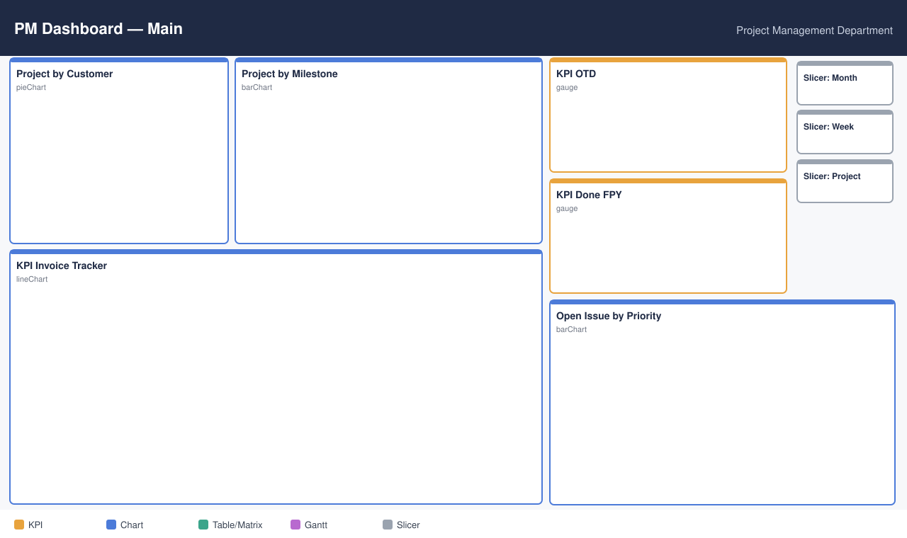
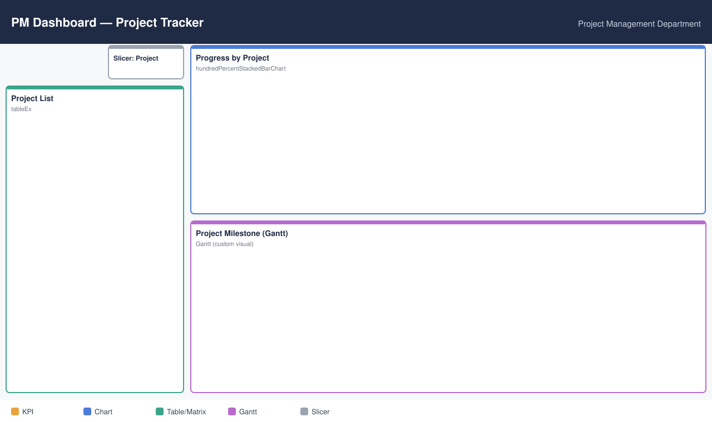
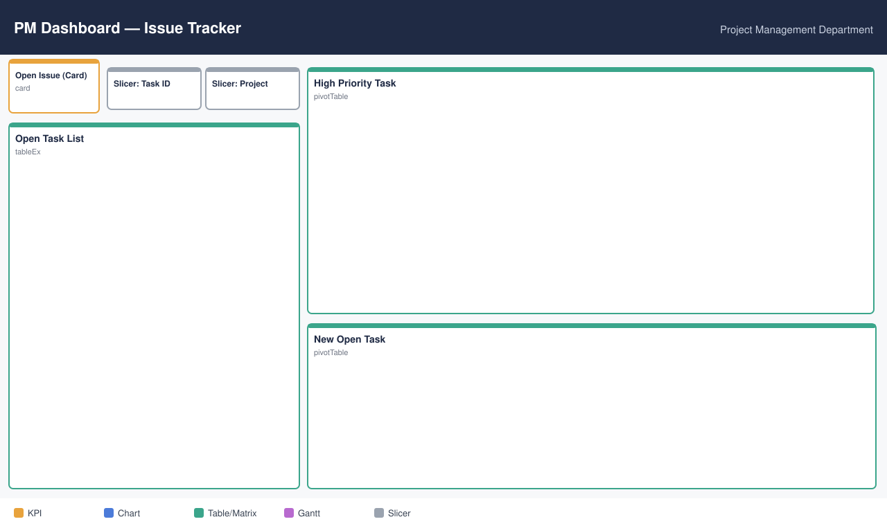
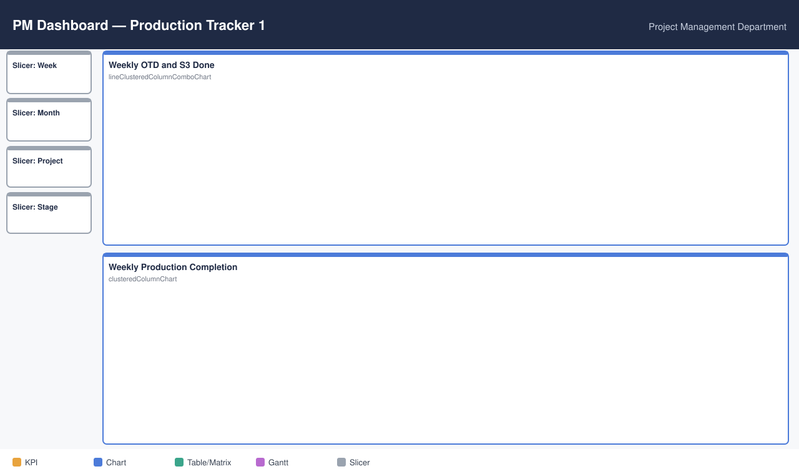
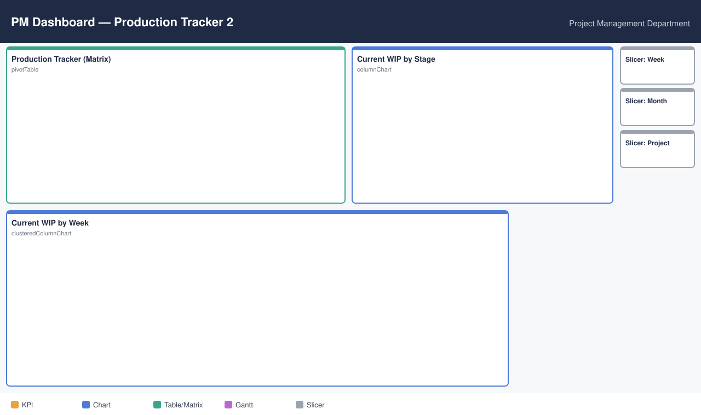

# PM Dashboard (Power BI)

제조 프로젝트 관리(PM) 부서용 Power BI 대시보드입니다. 프로젝트 마일스톤, 공정별 생산 진행, 납기(OTD)·품질(FPY)·청구 KPI, 미결 이슈를 한 보고서에서 조회합니다.
테이블명·컬럼명·공정 코드·프로젝트명은 익명화되어 있으며, 포트폴리오 공개본의 수치는 무작위 계수로 조정되어 실제 값과 다릅니다.

- 도구: Power BI Desktop (Power Query M, DAX)
- 데이터 소스: SharePoint 문서 라이브러리의 Excel 파일 5종 (`Excel.Workbook(Web.Contents(...))`)
- 커스텀 비주얼: Gantt Chart (AppSource)
- 페이지: 5개 (1280×720)

## 공정 코드 (익명화)

| 코드 | 의미 |
|---|---|
| `S0` | 1차 가공 공정 (시작/완료) |
| `S1` | 2차 공정 완료 |
| `S2` | 3차 공정 (시작/완료) |
| `S3` | 최종 조립 공정 (A/B 두 작업 중 빠른 시작일 = 공정 시작) |
| `Done` | 공정별 완료 태그 일자 |
| `Final Done` | 최종 품질 서류 완료 일자 |
| Unit | 생산 단위. Unit ID 마지막 문자 = 유닛 유형(6종) |

## 페이지 구성

### 1. Main


| 시각화 | 유형 | 내용 |
|---|---|---|
| Project by Customer | 원형 | 고객사별 프로젝트 수 |
| Project by Milestone | 막대 | 마일스톤 단계별 프로젝트 수 |
| KPI OTD | 게이지 | 고객 계획 대비 `S3` 완료율 (목표 98.5%) |
| KPI Done FPY | 게이지 | `S3` 완료 후 7일 이내 `Final Done` 비율 (목표 80%) |
| KPI Invoice Tracker | 꺾은선 | 월별 청구 목표·실적과 차이(보조축) |
| Open Issue by Priority | 막대 | 우선순위별 미결(`Open`) 이슈 수 |
| 슬라이서 | | 월 / 주차 / 프로젝트 |

### 2. Project Tracker


| 시각화 | 유형 | 내용 |
|---|---|---|
| Project List | 테이블 | 프로젝트명, 마일스톤 |
| Progress by Project | 100% 누적 막대 | 프로젝트별 유닛 진행 상태 비율 |
| Project Milestone | Gantt | 프로젝트별 생산 시작~종료 기간, 완료율 |

### 3. Issue Tracker


| 시각화 | 유형 | 내용 |
|---|---|---|
| Open Issue | 카드 | 미결 이슈 수 |
| Open Task List | 테이블 | 프로젝트, 내용, 우선순위 |
| High Priority Task | 행렬 | 우선순위 `High` 미결 이슈 (등록일·최근 업데이트·목표일) |
| New Open Task | 행렬 | 최근 7일 이내 등록된 미결 이슈 |

### 4. Production Tracker 1


| 시각화 | 유형 | 내용 |
|---|---|---|
| Weekly OTD and S3 Done | 막대+꺾은선 | 주차별 고객 계획 수량·`S3` 완료 수량, 차이(보조축) |
| Weekly Production Completion | 묶은 막대 | 주차별 `S1`/`S2`/`S3` 완료 유닛 수 |

### 5. Production Tracker 2


| 시각화 | 유형 | 내용 |
|---|---|---|
| Production Tracker | 행렬 | 프로젝트 × 유닛 유형별 `S1`·`S2`·`S3`·`Final Done`·청구·출하 수량 |
| Current WIP by Stage | 세로 막대 | 공정 단계별 현재 재공(WIP) 유닛 수 |
| Current WIP by Week | 묶은 막대 | 주차별·단계별 재공 유닛 수 |

## 데이터 모델

### 원천 테이블 (Power Query)

| 테이블 | 원천 | 주요 처리 |
|---|---|---|
| `Milestones` | PM 업무 정리 Excel – Milestones 시트 | 헤더 정리, 프로젝트명 생성, 단계 표시(●/O)로 `Milestone`·`MilestoneIndex` 산출, `__SalesProject` 병합으로 유닛 수량·유닛당 단가 계산, 고객사명 치환 |
| `_<Category>` 8개 | PM 업무 정리 Excel – 카테고리별 이슈 시트 | 동일 스키마(ID, Project, Open Date, Priority, Status, Target Due Date …)로 정리 후 `Milestones` 병합 |
| `__UnitRelease` | 유닛별 공정 일자 Excel | 유닛 유형 추출, 정렬 인덱스, 연초 이전 완료분 보정 컬럼, `ProjectID-UnitID` 키 생성 |
| `__UnitStatus` | 유닛 공정 진행 Excel | 필요 컬럼만 남기고 이름 변경, `S3 Start` = A/B 작업 중 빠른 날짜, 최신 일자 기준 `Status`·`StatusIndex` 산출 |
| `CustPlan` | 고객 계획/청구 Excel – 계획 시트 | 주차 컬럼(1~52) Unpivot → `week`, `OTD` |
| `InvoiceTarget` / `InvoiceActual` | 고객 계획/청구 Excel – 청구 시트 | 월 컬럼 Unpivot → `Month`, 목표/실적 |
| `__SalesProject` | 영업 프로젝트 목록 Excel | 2단 헤더 승격 |
| `__Priority` | 수기 입력 | High=1, Medium=2, Low=3 |

### 계산 테이블 (DAX)

| 테이블 | 정의 |
|---|---|
| `DateTable` | `GENERATESERIES(1,52,1)` 주차 테이블 + 주 시작일·월 계산 컬럼 |
| `TaskList` | `UNION`으로 8개 카테고리 이슈 테이블 통합 |
| `S1` / `S2` / `S3` / `FinalDone` / `INV` / `Ship` | `__UnitRelease`에서 공정별 완료 일자·주차·월·연도를 `SELECTCOLUMNS`로 분리 |
| `Done_FPY` | 유닛별 `S3 Done`·`Final Done` 일자 |
| `ProjectMilestone` | 프로젝트별 생산 시작(최소 `S0 Start`)·종료(최대 `S3 Complete`)·완료 유닛 수 (`SUMMARIZE`) |
| `Progress` | 프로젝트 × 상태 × 주차별 유닛 수 |
| `Completion` | 2025년 `S1`/`S2`/`S3` 주차별 완료 수를 `UNION`으로 통합 |

### 관계

- `CustPlan`, `InvoiceTarget`, `InvoiceActual` → `Milestones` (프로젝트명, M:1, 청구 2개는 비활성)
- `__UnitRelease` ↔ `__UnitStatus` (유닛 키, 1:1, 양방향)
- 공정별 테이블 ↔ `DateTable`(주차), ↔ `__UnitRelease`(유닛 유형)은 측정값에서 `USERELATIONSHIP`으로 지정해 사용

## 주요 DAX

전체 측정값·계산 컬럼은 [`measures.dax`](measures.dax), Power Query 주요 단계는 [`power_query.m`](power_query.m)에 정리했습니다.

**공정별 주간 완료 수** – 하나의 `DateTable`을 공정별 주차 컬럼과 `USERELATIONSHIP`으로 연결
```dax
S1 Done =
CALCULATE(
    COUNTA(S1[S1_Done]),
    USERELATIONSHIP(S1[S1 Week], DateTable[Weeknum]),
    USERELATIONSHIP(__UnitRelease[Unit Type], S1[Unit Type])
)
```

**OTD Rate** – 지난주까지의 고객 계획 수량 대비 `S3` 완료 수량
```dax
OTD Rate =
DIVIDE(
    CALCULATE(
        COUNTA(S3[S3_Done]),
        USERELATIONSHIP(S3[S3 Week], DateTable[Weeknum]),
        USERELATIONSHIP(CustPlan[Unit Type], S3[Unit Type])
    ),
    CALCULATE(
        SUM(CustPlan[OTD]),
        FILTER(DateTable, DateTable[Weeknum] < WEEKNUM(TODAY(), 2))
    )
)
```

**Done FPY** – `S3` 완료 후 8일 미만에 최종 완료된 유닛 비율
```dax
-- 계산 컬럼
Done FPY = IF([S3 Done].[Year] < 2025, "True",
              IF([Final Done].[Date] - [S3 Done].[Date] < 8, "True", "False"))

-- 측정값
Done FPY Rate =
CALCULATE(
    COUNTX(FILTER(Done_FPY, [Done FPY] = "True"), [Done FPY]) / COUNTA(Done_FPY[Done FPY]),
    YEAR(Done_FPY[Final Done]) = 2025,
    USERELATIONSHIP(Done_FPY[S3 Done Week], DateTable[Weeknum])
)
```

**주차별 공정 완료 (TREATAS)** – 물리적 관계 없이 `DateTable` 주차 필터를 `Completion` 주차 컬럼에 적용
```dax
Complete =
CALCULATE(
    SUM(Completion[Completed Unit]),
    TREATAS(VALUES(DateTable[Weeknum]), Completion[Completion wk]),
    USERELATIONSHIP(Completion[Project Desc], Milestones[ProjectName])
)
```

**주차 → 월 매핑** – 주 시작일이 월말 3일 이내면 다음 달로 귀속
```dax
WeekStart = MINX(FILTER(CALENDAR(DATE(2025,1,1), DATE(2025,12,31)),
                        WEEKNUM([Date], 2) = [Weeknum]), [Date])
Month = IF((ENDOFMONTH(DateTable[WeekStart].[Date]) - DateTable[WeekStart].[Date]) > 3,
           DateTable[WeekStart].[Month], DateTable[IgnoreDate].[Month])
```

## 공개본 익명화 처리

- 고객사명: Power Query `Table.ReplaceValue`로 `Customer1`~`Customer4` 치환
- 수치: 측정값에 무작위 조정 계수 적용 (본 문서의 DAX에서는 계수 제외)
- 회사명·원천 파일 경로·프로젝트명·공정 코드: 문서 내 일반 명칭으로 대체
